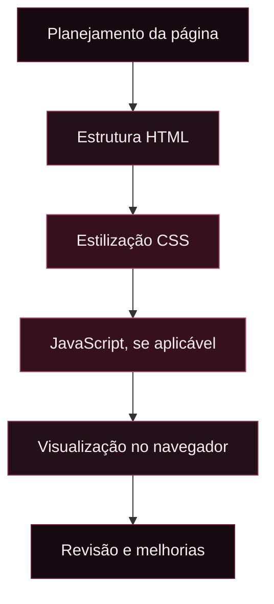

 <div align="center">


<br/>


<br/>

<a href="https://github.com/AndressaPapini/LandingPageFilme">

</a>
<a href="https://github.com/AndressaPapini/LandingPageFilme/commits/main">

</a>
<a href="https://github.com/AndressaPapini/LandingPageFilme/stargazers">

</a>

</div>

---

<div align="center">

### NAVEGUE PELA EXPERIÊNCIA

[ SOBRE ](#sobre-o-projeto)　•　[ TECNOLOGIAS ](#tecnologias)　•　[ EXECUÇÃO ](#como-executar)　•　[ ESTRUTURA ](#estrutura-do-projeto)　•　[ AUTORIA ](#autoria)

</div>

---

## SOBRE O PROJETO

O **Landing Page Filmes** é um projeto de desenvolvimento web com temática cinematográfica. Sua proposta visual explora o universo dos filmes por meio de uma página dedicada ao tema, reunindo estrutura, identidade visual e organização de conteúdo.

Este repositório faz parte da prática de desenvolvimento web e permite acompanhar a evolução do projeto por meio de seu código-fonte e histórico de alterações.

<div align="center">


</div>

## TECNOLOGIAS

<div align="center">

<a href="https://developer.mozilla.org/pt-BR/docs/Web/HTML">

</a>
<a href="https://developer.mozilla.org/pt-BR/docs/Web/CSS">

</a>
<a href="https://developer.mozilla.org/pt-BR/docs/Web/JavaScript">

</a>
<a href="https://code.visualstudio.com/">

</a>
<a href="https://git-scm.com/">

</a>

</div>

<details>
<summary><strong>HTML5 — Estrutura</strong></summary>

Responsável pela marcação e organização do conteúdo da página.

</details>

<details>
<summary><strong>CSS3 — Apresentação visual</strong></summary>

Permite definir cores, tipografia, espaçamentos, layouts e adaptação visual.

</details>

<details>
<summary><strong>JavaScript — Comportamento</strong></summary>

Pode ser utilizado para implementar interações na interface, conforme os recursos existentes no projeto.

</details>

---

## COMO EXECUTAR

<details open>
<summary><strong>Ver instruções de instalação</strong></summary>

**1. Clone o repositório**

```bash
git clone https://github.com/AndressaPapini/LandingPageFilme.git
```

**2. Entre na pasta**

```bash
cd LandingPageFilme
```

**3. Abra no VS Code**

```bash
code .
```

**4. Execute a página**

Localize o arquivo `index.html` na estrutura real do projeto e abra-o no navegador. Se estiver utilizando a extensão Live Server, você também pode iniciá-lo por ela.

> Os comandos pressupõem que o Git e o Visual Studio Code estejam instalados. O arquivo HTML e a forma de execução devem ser conferidos na estrutura do repositório.

</details>

---

## ESTRUTURA DO PROJETO

A árvore abaixo é ilustrativa. Ajuste os nomes de pastas e arquivos conforme a estrutura real do repositório.

```text
LandingPageFilme/
│
├── index.html
├── style.css
├── script.js
├── assets/
│   └── imagens/
│
└── README.md
```

---

## FLUXO DE DESENVOLVIMENTO



---

## ESTATÍSTICAS DO REPOSITÓRIO

<div align="center">

<a href="https://github.com/AndressaPapini/LandingPageFilme">

</a>

<a href="https://github.com/AndressaPapini/LandingPageFilme">

</a>

<br/>


</div>

<details>
<summary><strong>Sobre os indicadores</strong></summary>

- As estatísticas utilizam um serviço externo e podem demorar a atualizar.
- Os cartões apresentam dados do perfil público, não exclusivamente deste projeto.
- A lista de linguagens depende da análise dos repositórios pelo serviço.
- O selo de último commit depende da existência de commits no repositório.

</details>

---

## ACOMPANHE O PROJETO

<div align="center">

<a href="https://github.com/AndressaPapini/LandingPageFilme">

</a>
<a href="https://github.com/AndressaPapini/LandingPageFilme/commits/main">

</a>

</div>

---

## AUTORIA

<div align="center">

**ANDRESSA PAPINI**

Projeto de desenvolvimento web.

<a href="https://github.com/AndressaPapini">

</a>

<br/><br/>


</div>

